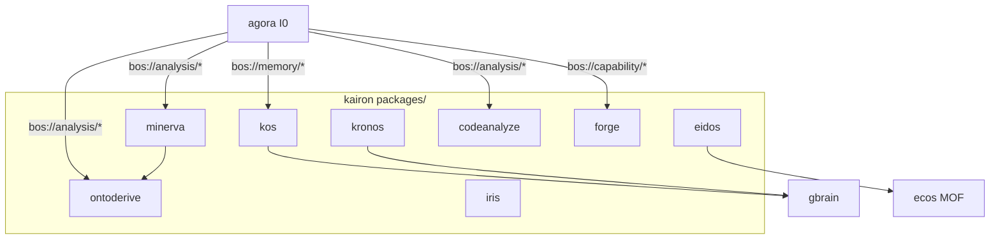

# kairon — Architecture

> **Layer**: L2 引擎面
> **Role**: 知识工程与研究引擎 / 14 packages monorepo (post 2026-07-26 cleanup, P30.5/STRAT-P81)
> **Stack**: Python 3.13+, uv workspace, pytest
> **Health**: See local CI and package-level verification
> **SSOT**: 运行时健康、测试规模、包数量以本项目 CI、本地测试命令和 workspace governance SSOT 为准
>
> **架构审计 (2026-07-13 → 2026-07-26 5 轮 review)**: 详见下方 §6 演进 + [`docs/analysis/architecture-audit-2026-07-13.md`](docs/analysis/architecture-audit-2026-07-13.md)
> 2026-07-26 累计清理: 11 broken module 修, 70 0-ref module 删, 21 跨项目 kairon_events 引用清
> ADR-0239 (P30 拆分清理), ADR-0241 (RUF100 + untrack), ADR-0243 (L0 orphan 删), ADR-0244 (4 巨包 0-ref)
>
> 系统全景参见：[`../../docs/PANORAMA.md`](../../docs/PANORAMA.md)

---

## 1. 内部架构



## 2. 入口

| Type | Entry | Port / Notes |
|:--|:--|:--|
| CLI | `per-package (kos, kronos, minerva, ...)` | 16 个 `__main__`, 开发调试用 |
| BOS | `bos://memory/*, bos://analysis/*, bos://persona/*` | agora 统一外部入口 |
| MCP | 9 个 server (kos/minerva/eidos/ontoderive/kronos/iris/sophia/forge) | ⚠️ 碎片化 + 协议割裂 (kos/eidos stdio 手写, 其他 FastMCP); 见审计 §2 |

## 3. 核心模块

| Module | Responsibility |
|:--|:--|
| `packages/kos/` | 跨域语义搜索 / KOS 知识图谱 |
| `packages/minerva/` | 深度研究引擎 |
| `packages/eidos/` | 认知记忆系统 (memory/nks/continuity/CRDT/learning + schema) — **kairon 枢纽**, 36K LOC, 被 codeanalyze/iris/kos/minerva 依赖 (反向零耦合) |
| `packages/kronos/` | 知识摄取管线 |
| `packages/ontoderive/` | 本体推导与推理 — 28K LOC, **BOS 入口型** (agora `bos://analysis/ontoderive/derive` 活路由, 非死包) |
| `packages/codeanalyze/` | AST 代码分析 |
| `packages/forge/` | Agent/工具集市 |
| `packages/iris/` | 发现与召回 |

## 4. 测试

```bash
cd projects/kairon && make test-diff  # or make test
```

## 5. 架构概览

参见工作区架构概览图：[`../../docs/ARCHITECTURE-DIAGRAM.md`](../../docs/ARCHITECTURE-DIAGRAM.md)

## 6. 演进 (2026-07-26, 5 轮 review + 4 PR 清理)

### 6.1 当前包清单 (post P30.5 / 5 轮 review)

14 packages (2026-07-26, post kairon-lib-events 删除 + 70 0-ref module 删除)

| 包 | LOC (src) | 角色 | 状态 |
|----|----------|------|------|
| **eidos** | 9.6K | 认知记忆系统 (kairon 枢纽, 0 broken module) | ✅ |
| **ontoderive** | 12K | 本体推导 (BOS 入口型, 0 broken) | ✅ |
| **minerva** | 22K | 深度研究 (1 consumer, 0 broken) | ✅ |
| **kos** | 25K | 跨域语义搜索 (次枢纽, FastMCP 44 工具) | ✅ |
| forge | 9.3K | 资产管理 | ✅ |
| codeanalyze | 9.2K | AST 分析 | ✅ |
| iris | 8.8K | 连接器 (含 WPS 微信读书) | ✅ |
| kronos | 3.3K | 知识摄取 | ✅ |
| sophia | 1.8K | 符号研究 | ✅ |
| kairon-utils | 2.8K | 共享工具 | ✅ |
| kairon-observability | 2.1K | 监控/告警 | ✅ |
| kairon-pipeline | 1.0K | 数据流水线 | ✅ |
| kairon-plugin-sdk | 1.2K | 插件 SDK | ✅ |
| health-profile | 0.5K | 健康画像 | ✅ |
| core-models | 2.0K | 核心模型 (2 BOS 入口) | ✅ (BOS 入口型) |

### 6.2 4 PR 清理汇总 (2026-07-25~26)

| PR | 标题 | 删除/修 | 关键变化 |
|----|------|---------|----------|
| #512 | chore(kairon): delete 9 eidos + 1 ontoderive broken modules | 10 files | 11 broken module → 0 |
| #518 | RUF100 cleanup + untrack 3286 _derivation_logs | 14+3286 files | lint 净, working tree 治本 |
| #519 | kairon_events L0 orphan cleanup (3 submodule) | 1 包 + 4 文件 | aetherforge + agora + kairon 3-way sync |
| (本 PR) | delete 70 zero-reference root modules (4 巨包) | 70 files | eidos/ontoderive/minerva root 平铺拆 |

### 6.3 累计指标变化

| 维度 | Before (2026-07-25) | After (2026-07-26) |
|------|---------------------|----------------------|
| 4 巨包 broken module | 11 | **0** |
| 0-ref root module | ~93 files | **23 files** (前 70 删) |
| tracked _derivation_logs | 3286 | **0** |
| 跨项目 kairon_events 引用 | 5 (3 项目) | **0** (P30.5 orphan 删) |
| kairon-lib-events 包 | 1 (live) | **0** (删) |
| 总 tracked files (kairon) | 4700 | **1300** (减 72%) |
| MCP 协议 | FastMCP 7/7 + 1 shim | FastMCP 7/7 + 1 shim (已统一, 0 改动) |

### 6.4 后续债 (留 P3+ 长期)

- minerva 26K god module 拆解 (4 PR)
- eidos 64 → 17 sub-package 完整拆 (留长期)
- 测覆 70% 声明 vs 实际 19% — CI gate 启用 + 增量
- 跨项目 API 文档同步 (kairon → agora/aetherforge/runtime)
