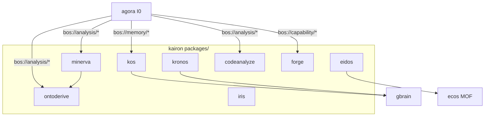

# kairon — Architecture

> **Layer**: L2 引擎面  
> **Role**: 知识工程与研究引擎 / 16 packages monorepo
> **Stack**: Python 3.13+, uv workspace, pytest
> **Health**: See local CI and package-level verification
> **SSOT**: 运行时健康、测试规模、包数量以本项目 CI、本地测试命令和 workspace governance SSOT 为准
>
> **架构审计 (2026-07-13)**: [`docs/analysis/architecture-audit-2026-07-13.md`](docs/analysis/architecture-audit-2026-07-13.md) — 包 LOC + 跨包依赖实测 + 9 MCP server 盘点 + 演进规划
>
> 系统全景参见：[`../../docs/PANORAMA.md`](../../docs/PANORAMA.md)

---

## 1. 内部架构



## 2. 入口

| Type | Entry | Port / Notes |
|:--|:--|:--|
| CLI | `per-package (kos, kronos, minerva, ...)` | 16 个 `__main__`, 开发调试用 |
| BOS | `bos://memory/*, bos://analysis/*, bos://persona/*` | agora 统一外部入口 |
| MCP | 9 个 server (kos/minerva/eidos/ontoderive/kronos/iris/sophia/forge) | ⚠️ 碎片化 + 协议割裂 (kos/eidos stdio 手写, 其他 FastMCP); 见审计 §2 |

## 3. 核心模块

| Module | Responsibility |
|:--|:--|
| `packages/kos/` | 跨域语义搜索 / KOS 知识图谱 |
| `packages/minerva/` | 深度研究引擎 |
| `packages/eidos/` | 认知记忆系统 (memory/nks/continuity/CRDT/learning + schema) — **kairon 枢纽**, 36K LOC, 被 codeanalyze/iris/kos/minerva 依赖 (反向零耦合) |
| `packages/kronos/` | 知识摄取管线 |
| `packages/ontoderive/` | 本体推导与推理 — 28K LOC, **BOS 入口型** (agora `bos://analysis/ontoderive/derive` 活路由, 非死包) |
| `packages/codeanalyze/` | AST 代码分析 |
| `packages/forge/` | Agent/工具集市 |
| `packages/iris/` | 发现与召回 |

## 4. 测试

```bash
cd projects/kairon && make test-diff  # or make test
```

## 架构概览

参见工作区架构概览图：[`../../docs/ARCHITECTURE-DIAGRAM.md`](../../docs/ARCHITECTURE-DIAGRAM.md)
