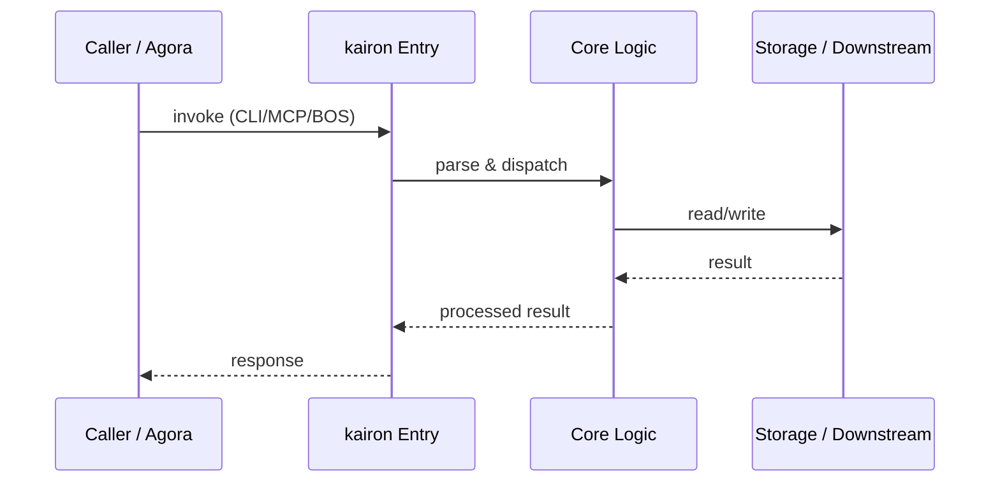

# kairon — Call Chain

> 本文档描述 kairon 内部最核心的一条调用链 / 数据流。
>
> 通用跨层调用链参见：[`../../docs/I0-AGORA-CALLCHAIN.md`](../../docs/I0-AGORA-CALLCHAIN.md)

---

## 关键路径

1. 1. Agora routes `bos://memory/kos/search` to kos CLI via stdio
2. 2. `kos.cli` parses args, loads index/config, executes hybrid search
3. 3. For deep research, `minerva` may call `ontoderive` or `codeanalyze` internally
4. 4. `eidos` validates schemas before persistence
5. 5. Results returned as JSON via stdio → agora → caller

## Sequence Diagram

